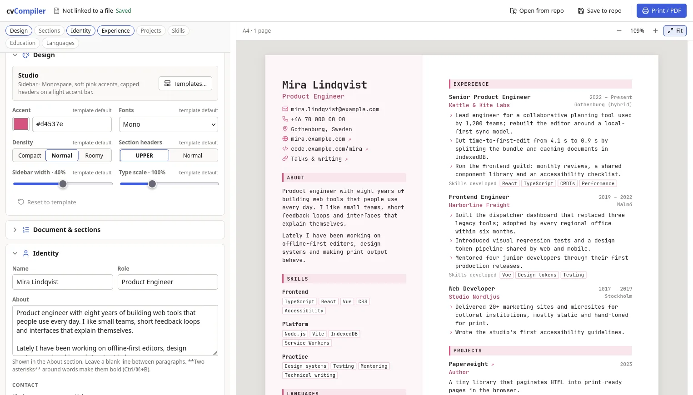
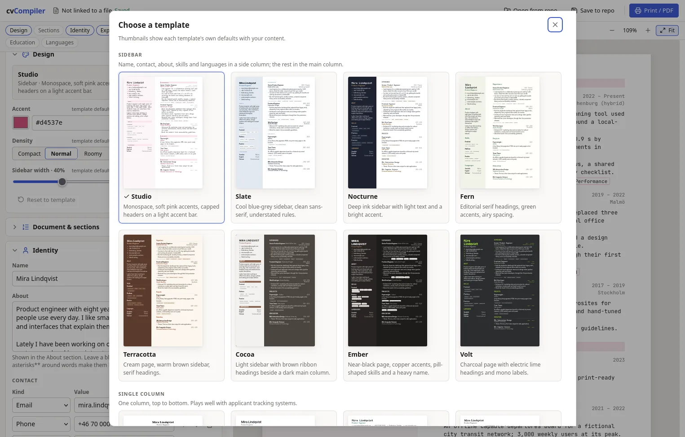
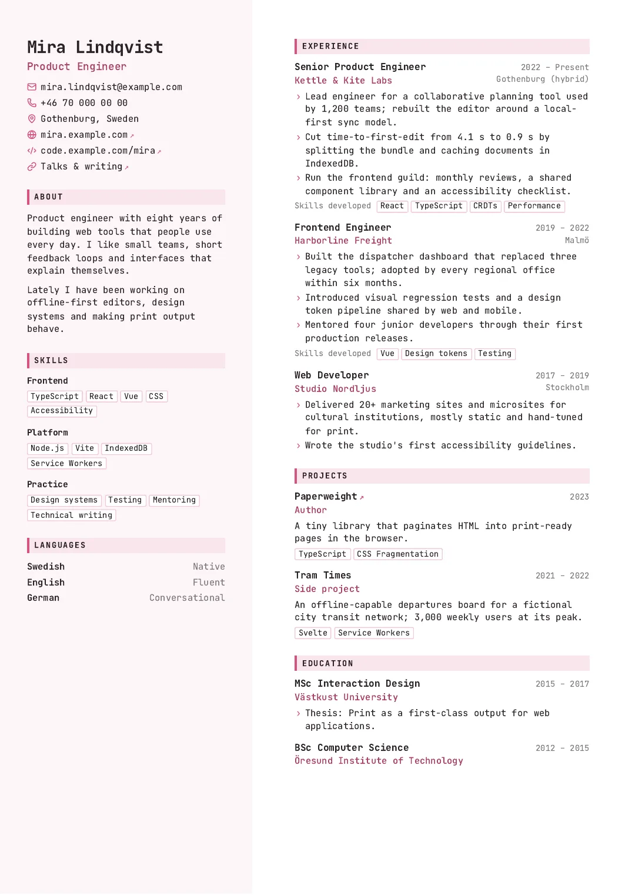

# cvCompiler

A static, local-first CV editor. Edit a structured CV in a form next to a live
A4 preview, then export a styled PDF with the browser's **Print → Save as PDF**.
There is no backend, no account and no tracking: your CV stays on your machine.



## Quick start

You need [Node.js](https://nodejs.org) 18.18 or newer and a modern browser
(Chrome, Edge, Brave or Arc give the best experience; Firefox and Safari work
too).

```bash
git clone https://github.com/slowTake/cvCompiler.git
cd cvCompiler
npm install
npm run dev
```

Open <http://localhost:5173>. The app starts with a fictional demo CV so you
can see how everything works before you enter anything of your own.

## User guide

### 1. Edit your CV

The left panel is the form; the right panel is the live preview, which
updates as you type. Use the chips at the top of the form to jump to a
section: Design, Sections, Identity, Skills, Education, Experience, Projects
and Languages. You can also click text in the preview to jump to the matching
field.

- **Entries** (jobs, education, projects) can be added, reordered with the
  up/down arrows, and deleted.
- **Bold** a word in any description by wrapping it in `**double asterisks**`
  or by selecting it and pressing Ctrl/⌘+B.
- **Contact** details are a list: pick a kind (phone, email, website, …) and
  a value. Add as many as you like.
- **Document & sections** lets you rename sections, hide ones you don't want,
  and move any section between the columns.

### 2. Pick a design

Open **Design → Templates…** and choose from ten templates, grouped by layout:
sidebar, single column (the most ATS-friendly) and header band. Your content
is kept when you switch.



Under **Design** you can also override the accent colour, fonts, density,
header case, sidebar width and type scale. **Reset to template** undoes all
overrides.

### 3. Save your work

Changes are cached in your browser automatically, but that is not a backup.
Keep the real copy in a file:

- **Chrome / Edge / Brave / Arc:** click **Open…** to bind a `.json` file,
  then **Save** (Ctrl/⌘+S) writes straight back to it. **Save as…** picks a
  new file.
- **Any browser:** **Export** downloads the JSON, **Import** loads one.

**Demo** resets to the fictional sample CV.

### 4. Export a PDF

Click **Print / PDF** (or press Ctrl/⌘+P) and in the print dialog set:

| Setting             | Value                |
| ------------------- | -------------------- |
| Destination         | Save as PDF          |
| Paper size          | A4                   |
| Margins             | None                 |
| Background graphics | **On**               |
| Headers and footers | Off                  |



Entries never split across pages and the preview shows the same page breaks
as the PDF.

## Scripts and setup

Requires Node 18.18 or newer.

```bash
npm install
npm run dev        # http://localhost:5173
```

| Script            | What it does                                  |
| ----------------- | --------------------------------------------- |
| `npm run dev`     | Dev server with hot reload                    |
| `npm run build`   | Type-check and build the static site to `dist/` |
| `npm run preview` | Serve the production build locally            |
| `npm run lint`    | oxlint (warnings fail the run)                |
| `npm test`        | Vitest unit tests                             |

## Saving your CV

The document is one JSON file ([schema](docs/DATA-MODEL.md)). There are three
places it can live:

1. **A file on disk (Chromium browsers: Chrome, Edge, Brave, Arc).**
   **Open…** binds a `.json` file through the File System Access API; **Save**
   (⌘S / Ctrl+S) writes straight back to it, and **Save as…** (⇧⌘S /
   Ctrl+Shift+S) picks a new file. The first save after opening asks for
   write permission, because files opened for reading are read-only until you
   allow it. The top bar shows the bound file name and a **● Unsaved** marker
   while you have changes that aren't on disk.
2. **Import / Export JSON (every browser).** Export downloads the document;
   Import loads one. In Firefox and Safari, ⌘S / Ctrl+S exports. Import checks
   the file and lists clear errors for broken structure (with the JSON path
   of each problem). Invalid optional values are dropped quietly.
3. **Browser storage (automatic).** Every change is cached in `localStorage`
   so a reload or crash doesn't lose work. This is a cache, not a backup:
   clearing site data removes it. Keep the real copy in a file.

**Demo** replaces the document with the fictional sample CV.

### Private data during development

`data/cv.public.json` is the shipped demo and contains only fictional data.
To work on your own CV in dev, put it in `data/cv.private.json`. That file:

- is gitignored;
- loads only in `npm run dev` (behind an `import.meta.env.DEV` guard) when
  there is no cached document yet, or via the **Private** button;
- never reaches the production bundle. The DEV branch is removed from builds,
  and as a second line of defence `vite.config.ts` swaps the file for `null`
  in any production build.

## Exporting a PDF

Click **Print / PDF** (or press ⌘P / Ctrl+P). In the print dialog choose:

- **Destination:** Save as PDF
- **Paper size:** A4
- **Margins: None.** The CV already has its own page margins.
- **Background graphics: on** (Chrome: *More settings → Background graphics*;
  Safari: *Print backgrounds*; Firefox: *Print backgrounds*). Without it,
  sidebars, header bands and accent bars come out white.
- Headers and footers: off.

Only the CV is printed. Entries never split across pages, section headings
stay with their first entry, page and sidebar backgrounds repeat on every
page, and column padding repeats at the top of each new page. The on-screen
preview simulates the same page breaks, so the page count and break points
you see should closely match the PDF. The PDF's default file name comes from
the document title (*Document & sections → Document title*).

## Templates

A template is a **layout skeleton × theme**. There are three skeletons:

- **Sidebar**: name, contact, about and skills in a side column (30–50% wide),
  everything else in the main column.
- **Single column**: top to bottom. The most ATS-friendly.
- **Header band**: a coloured band with name and contact over a
  single-column body.

Ten templates ship: Studio (default), Slate, Nocturne, Fern, Classic,
Minimal, Ledger, Harbor, Sunrise and Graphite. Pick one from the thumbnail
gallery under **Design → Templates…**.

**Design** also lets you override the accent colour, font pairing, density,
header case, sidebar width and type scale. Overrides are stored in the
document (`meta.style`), survive template switches, and **Reset to template**
clears them. Setting a control back to the current template's own value
removes that override. You get a warning if the accent has less than 3:1 contrast
against the page, but you can still use it.

### Adding a template

On an existing skeleton you need no component code:

1. Add an entry to `TEMPLATES` in `src/templates/registry.ts`: id, name,
   description, skeleton and defaults for every style knob.
2. Add `src/templates/themes/<id>.css` with a single token block:
   ```css
   .cv-theme-<id> {
     --cv-ink: #1b2430;
     --cv-heading-rule: 2px solid var(--cv-accent-soft);
     /* … */
   }
   ```
   Theme files are loaded automatically. The full token list, with
   defaults, is at the top of `src/styles/cv.css`.

The CV preview reads only `--cv-*` custom properties, and the editor's own
UI uses a separate `--ui-*` set, so a theme can't restyle the editor. Tests
enforce this: theme files may only declare `--cv-*` properties.

## Project layout

```
data/                 demo CV (+ your gitignored cv.private.json)
docs/DATA-MODEL.md    the JSON schema
docs/images/          README screenshots
src/model/            types, parsing/normalising, style overrides, colour maths
src/templates/        registry, skeleton metadata, theme token blocks
src/preview/          CV renderer, skeleton components, pagination, print root
src/editor/           form: one component per section, plus shared fields
src/persistence/      localStorage cache, File System Access, import/export
src/styles/           cv.css (CV structure), ui.css (editor), print.css
tests/                Vitest suites
```

## Running it

cvCompiler has no hosted version. Run it locally with `npm run dev`, or
`npm run build` followed by `npm run preview`. The build in `dist/` is plain
static files, so any static host will serve it.

## License

[MIT](LICENSE)
